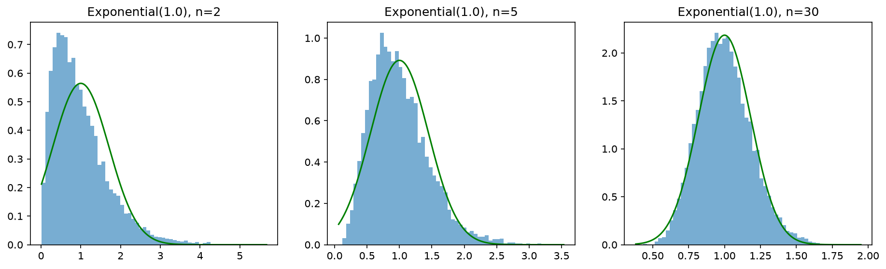
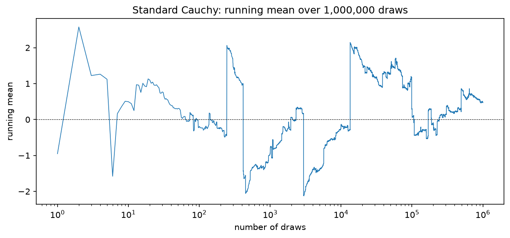
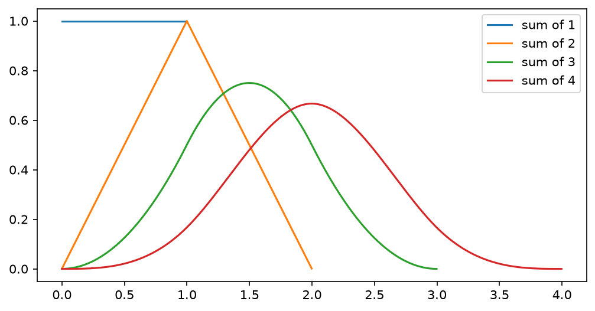

# The Central Limit Theorem — Notes

## The statement

The distribution of the sample mean tends to normal as the sample size n grows. More precisely, for iid draws from a population with mean μ and **finite** variance σ²:

- the mean of the sample means is **μ**
- their standard deviation (the *standard error*) is **σ/√n**
- their shape, after recentring and rescaling, approaches a normal as n grows

## Why σ/√n

Independent variances add, so Var(X₁ + … + Xₙ) = nσ². Dividing the sum by n divides the variance by n²:

Var(mean) = nσ²/n² = σ²/n, so the standard deviation is σ/√n.

This uses only independence and a finite σ². It says nothing about *shape*, and it fails outright if σ² is not a number (Cauchy).

## Part 1: Exponential(1)

Population: mean μ = 1, σ = 1, skewness 2.

Parameter gotcha: the exponential has **rate** λ (events per unit time), but `rng.exponential` takes the **scale** β = 1/λ. With λ = 1 they coincide, so the bug hides. The code passes `1 / rate`.

  

10,000 sample means per n:

| n | mean | std | 1/√n | skew | 2/√n |
|---|---|---|---|---|---|
| 2 | 0.993 | 0.704 | 0.707 | 1.401 | 1.414 |
| 5 | 1.000 | 0.450 | 0.447 | 0.926 | 0.894 |
| 30 | 1.000 | 0.186 | 0.183 | 0.382 | 0.365 |

The n=30 std of 0.186 against 1/√30 = 0.183 confirms the spread check.

### Leftover skew

At n=30 the histogram is still visibly right-skewed: the peak sits left of the normal's peak and the tail is longer on the right. The skewness of the mean of n iid draws is the population skewness divided by √n, so for Exp(1) it is **2/√n** (about 0.37 at n=30). Skewness fades slowly, so the folklore "n=30" is a rough guide only.

### Noise in the estimate

The gap between empirical and predicted skew is sampling noise. Mean absolute gap at n=5, averaged over 20 seeds:

| reps | mean gap |
|---|---|
| 10,000 | 0.0326 |
| 100,000 | 0.0075 |
| 1,000,000 | 0.0021 |

Each 10× in reps shrinks the gap 3.6–4.3×, against the predicted √10 ≈ 3.16×. That matches the 1/√reps scaling, with slightly faster shrinkage. Skewness depends on the third moment, so a few tail values make it a noisy statistic.

## Part 2: Cauchy

The standard Cauchy density is 1/(π(1+x²)). Its tails fall like 1/x², far slower than an exponential's.

  

The running mean of one stream of 1,000,000 draws **never converges**. It stays within a few units of 0 but makes sudden jumps at any scale, including after 100,000 draws. A single enormous draw can dominate the whole sum, then the running mean decays back like 1/n as that value is divided by a growing count.

(I did not run the Cauchy version of the n = 2, 5, 30 histograms; only the running-mean stream.)

### What breaks the theorem

- The mean is E[X] = ∫ x f(x) dx, and x·f(x) decays like 1/x. Since ∫₁^∞ (1/x) dx = ln(∞) = ∞, each half of the integral diverges, and the total is ∞ − ∞, which is **undefined**. Symmetry about 0 only gives a centre (the median) and cannot rescue it, because cancelling needs each half to be finite.
- The variance is undefined too, so the derivation of σ/√n has nothing to start from.
- The mean of n iid standard Cauchy draws is itself **standard Cauchy, for every n**. Averaging does not narrow it. That is why the running mean at any point is a fresh draw from the same distribution: about half the time within ±1, with the same chance of a wild jump.

## Why the bell shape (convolution view)

The density of a sum of independent variables is the **convolution** of their densities. Repeated convolution is a smoothing operation, so sharp features wash out.

  

A flat Uniform(0,1) density becomes a triangle at k=2, a smooth piecewise-quadratic hump at k=3, and a clear bell at k=4. The sum drifts right and widens (support [0, k]), so the bell only appears as the *limit* after recentring and rescaling by (sum − nμ)/(σ√n), which is why finite mean and variance matter.

On a grid with spacing `dx`, a density has area `g.sum() * dx ≈ 1`. `np.convolve(g, f) * dx` preserves that area, so no extra normalisation is needed.

### Why the *normal* specifically

The normal is a **fixed point** of summing: the sum of independent normals is normal, with only the width changing. With finite variance, repeated summing is pulled toward that fixed point. The Cauchy is also a fixed point (a sum of Cauchys is Cauchy), but it is a different one, and its heavy tails mean nothing pulls it toward the normal. This is an intuition, not a proof; I haven't tested the recentred and rescaled k=4 curve against a normal overlay.

## Code notes

- `sampling_dist` draws the means, plots the histogram plus the N(μ, σ/√n) overlay, and returns the means.
- `clt_exponential_dist`, `check_skew_exponential_dist`, `running_sample_mean_cauchy_dist` and `uniform_convolution_test` each have a docstring. Plots are saved next to the script rather than shown interactively.
- The running mean is `np.cumsum(draws) / np.arange(1, n + 1)`: O(n) and vectorised. It is a *cumulative* mean, not a fixed-window moving average.
- Format `.3g` means 3 significant figures; `.3f` means 3 decimal places.

## Not done

- The Cauchy n = 2, 5, 30 histograms and a check that the sample-mean spread does not shrink (std is meaningless; use the IQR or the fraction within ±1).
- Extension: lognormal σ=1.5, QQ-plot against the normal to find roughly what n looks Gaussian, compared with the n=30 folklore.
