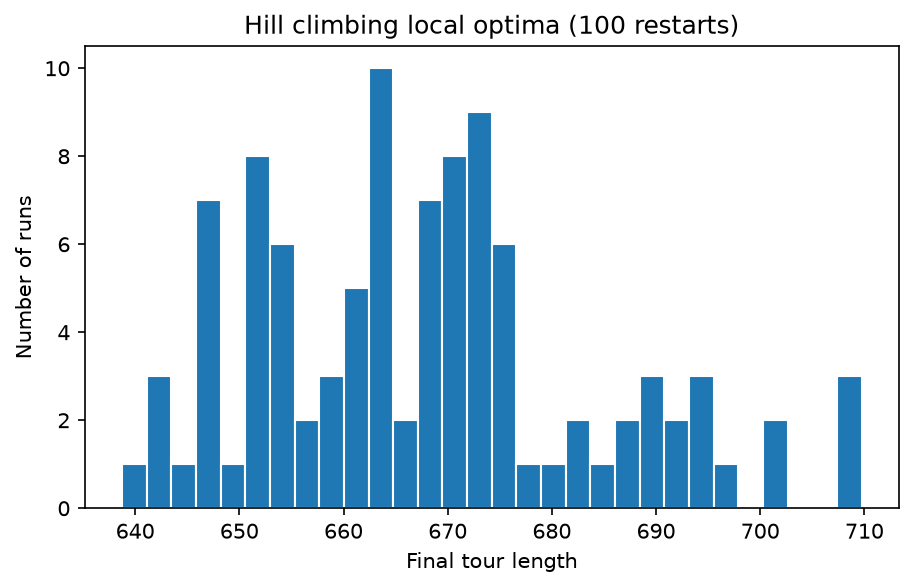
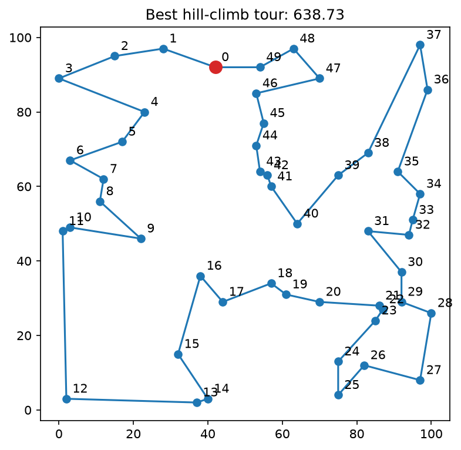

# Simulated Annealing — Notes

**Setup:** find a short closed tour through a set of cities (the travelling salesman problem). Build local search on it: hill climbing first, then simulated annealing. The 12-city instance has a known optimum of 298.99 (Held–Karp), so it works as ground truth.

## Status

Hill climbing is done on 12 and 50 cities. **Annealing is not written yet.** See *Not done*.

## Tours and the 2-opt move

A tour is a list of city indices in visiting order, and it is a **loop**: the last city connects back to the first. Forgetting that closing edge is the easy bug in `tour_length`. Python's `tour[-1]` gives it for free: pair every `tour[ii-1]` with `tour[ii]`.

**2-opt** removes two edges and reconnects the tour the only other way that stays one loop. In list terms it is reversing a segment, `tour[:i] + tour[i:j+1][::-1] + tour[j+1:]`. The name comes from the k-opt family: *k* edges removed. A tour is **2-optimal** when no single 2-opt move shortens it.

Any crossing can be removed by a 2-opt move that shortens the tour, so a 2-optimal tour has **no crossings**. The converse fails: a tour with no crossings can still be improved by moves that don't remove a crossing, so "no crossings" is not the stopping test. The test is "no move has Δ < 0".

## The O(1) delta

Reversing positions `i..j` leaves the edges *inside* the segment unchanged (they are only walked backwards). Only the two boundary edges change. With `a = tour[i-1]`, `b = tour[i]`, `c = tour[j]`, `d = tour[(j+1) % n]`:

Δ = d(a,c) + d(b,d) − d(a,b) − d(c,d)

Negative Δ means an improving move. Edge cases, all found by the brute-force test:

- `i = 0`: `a` wraps to the last city (`tour[-1]` does it).
- `j = n-1`: `d` must wrap to `tour[0]`; `tour[j+1]` raises `IndexError`. Use `% n`.
- `i = 0` and `j = n-1` together: the whole loop is reversed, which gives the same loop backwards with the same length. The formula would wrongly give −2·d(i,j), so the function returns 0 for `abs(i-j) == n-1`.

`check_two_opt_delta` compares the O(1) delta with `tour_length(two_opt(...)) - tour_length(...)` for every `i < j` on random tours, using `math.isclose(..., abs_tol=1e-6)`. The tolerance is absolute because Δ is often near 0.

## Hill climbing

Best-improvement (steepest descent): scan every `i < j`, apply the single most negative Δ, repeat until a full scan finds none. That scan is what proves the result is a local optimum. Two details:

- `best_delta` starts at **−1e-9**, not 0, so floating-point noise (a "Δ" of −1e-14) can't be accepted as an improvement and cycle forever.
- A bug I had at first: `hill_climb` called itself recursively inside its own `while` loop and discarded the result. The loop already does the repeating, so the call only wasted work.

### 12 cities: it just works

Every restart reached 298.99. The first 5 runs did (initial lengths 589–692), and so did 1000 of 1000 in a later run. The final tours differ as lists but are the same loop, rotated or reversed.

That contradicts the problem file's "single-run hill climbing typically strands a few percent above", at least for this climber on this instance. With 12 cities the landscape is easy for steepest-descent 2-opt, so annealing can't beat it here. A weaker climber (first-improvement in random order, or adjacent swaps only) would probably show real local optima, but I haven't tried it.

### 50 random cities: it doesn't

`random_cities(50, seed=1)`, 100 restarts:

  

The local optima run from about 639 to 710, a spread of roughly 10%, and almost every restart ends somewhere different. The best tour has length 638.73:

  

It has no crossings, as expected, but it still has long diagonals and doubling back. Fixing those needs several coordinated moves whose intermediate tours are worse, which is what accepting a worse move sometimes could allow.

A rough yardstick from the random-uniform TSP constant, 0.7124·√(n·A), gives about 500 for n = 50, A = 10,000, and the boundary effect pushes the true optimum higher. My guess is somewhere around 550–600. **This is a formula-based guess, not a measured value.**

## Code notes

- **`TSP` class:** holds the cities and a precomputed pairwise distance matrix, so a delta is four table lookups. `tour_length`, `two_opt_delta`, `hill_climb`, `plot_tour`, `check_two_opt_delta` and `random_tour` are methods. This replaced a module-level `cities` global, which made 12-city and 50-city instances impossible to use side by side.
- **`random_cities`:** uses its own `random.Random(seed)`, so a fixed seed fixes the cities without touching the global random state used for tours.
- **Plot helpers:** `plot_histogram` and `save_tour_plot` write PNGs next to the script via `Path(__file__).parent`.
- `math.dist` / `math.hypot` beat `np.sqrt` for single points, since numpy has per-call overhead on scalars.
- The brute-force check was run on both instances after the refactor.

## Not done

- **Simulated annealing itself.** Decisions still to make: how to propose one random `(i, j)` with `i < j`; accept worsening moves with probability exp(−Δ/T); schedule T from 100, ×0.999 per step, ~50k steps (final T is 100·0.999^50000, which I haven't computed yet).
- The trace plot of tour length over time, and the comparison of best-of-20 hill climbing vs one annealing run vs the 298.99 optimum.
- **Held–Karp** DP to confirm 298.99 independently.
- Tuning the schedule on 50 cities, and what "tuned well" means without ground truth.
- A weaker hill climber, to see non-trivial local optima on the 12 cities.
