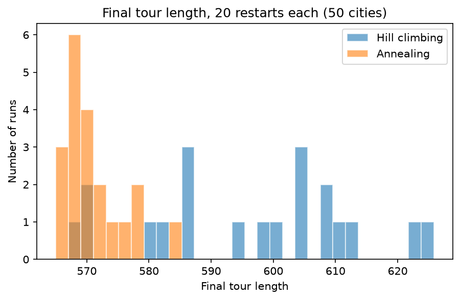
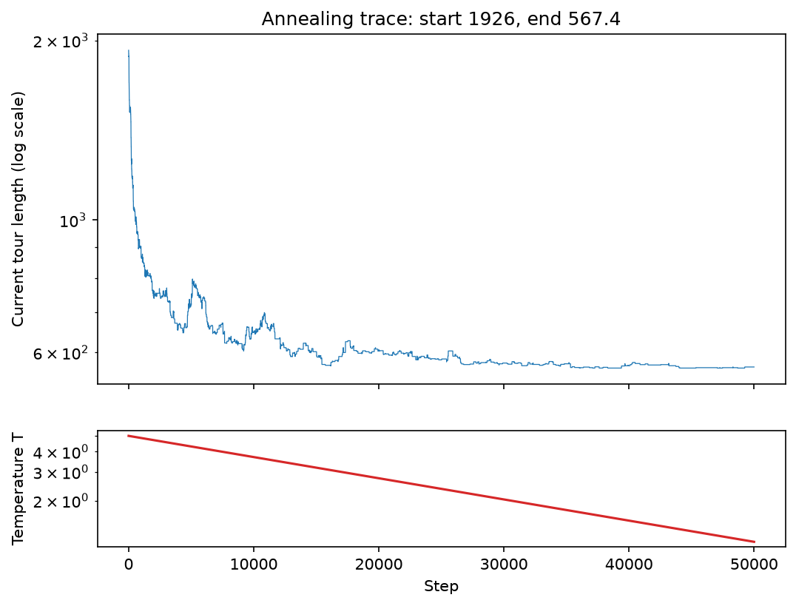

# Simulated Annealing — Notes

**Setup:** find a short closed tour through a set of cities (the travelling salesman problem). Build local search on it: hill climbing first, then simulated annealing. The 12-city instance has a known optimum of 298.99 (Held–Karp), so it works as ground truth. On 50 random cities nothing is known exactly, so methods are compared against each other.

## Tours and the 2-opt move

A tour is a list of city indices in visiting order, and it is a **loop**: the last city connects back to the first. Forgetting that closing edge is the easy bug in `tour_length`. Python's `tour[-1]` gives it for free: pair every `tour[ii-1]` with `tour[ii]`.

**2-opt** removes two edges and reconnects the tour the only other way that stays one loop. In list terms it is reversing a segment, `tour[:i] + tour[i:j+1][::-1] + tour[j+1:]`. The name comes from the k-opt family: *k* edges removed. A tour is **2-optimal** when no single 2-opt move shortens it.

Any crossing can be removed by a 2-opt move that shortens the tour, so a 2-optimal tour has **no crossings**. The converse fails: a tour with no crossings can still be improved by moves that don't remove a crossing, so "no crossings" is not the stopping test. The test is "no move has Δ < 0".

## The O(1) delta

Reversing positions `i..j` leaves the edges *inside* the segment unchanged (they are only walked backwards). Only the two boundary edges change. With `a = tour[i-1]`, `b = tour[i]`, `c = tour[j]`, `d = tour[(j+1) % n]`:

Δ = d(a,c) + d(b,d) − d(a,b) − d(c,d)

Negative Δ means an improving move. Edge cases, all found by the brute-force test:

- `i = 0`: `a` wraps to the last city (`tour[-1]` does it).
- `j = n-1`: `d` must wrap to `tour[0]`; `tour[j+1]` raises `IndexError`. Use `% n`.
- `i = 0` and `j = n-1` together: the whole loop is reversed, which gives the same loop backwards with the same length. The formula would wrongly give −2·d(i,j), so the function returns 0 for `abs(i-j) == n-1`.

`check_two_opt_delta` compares the O(1) delta with `tour_length(two_opt(...)) - tour_length(...)` for every `i < j` on random tours, using `math.isclose(..., abs_tol=1e-6)`. The tolerance is absolute because Δ is often near 0. (The call was in `main` after the `TSP` refactor but has since been removed; the method is still there.)

## Hill climbing

Best-improvement (steepest descent): scan every `i < j`, apply the single most negative Δ, repeat until a full scan finds none. That scan is what proves the result is a local optimum. Two details:

- `best_delta` starts at **−1e-9**, not 0, so floating-point noise (a "Δ" of −1e-14) can't be accepted as an improvement and cycle forever.
- A bug I had at first: `hill_climb` called itself recursively inside its own `while` loop and discarded the result. The loop already does the repeating, so the call only wasted work.

### 12 cities: it just works

Every restart reached 298.99. The first 5 runs did (initial lengths 589–692), and so did 1000 of 1000 in a later run. The final tours differ as lists but are the same loop, rotated or reversed.

That contradicts the problem file's "single-run hill climbing typically strands a few percent above", at least for this climber on this instance. With 12 cities the landscape is easy for steepest-descent 2-opt, so annealing can't beat it here. A weaker climber (first-improvement in random order, or adjacent swaps only) would probably show real local optima, but I haven't tried it.

### 50 random cities: it doesn't

On `random_cities(50, seed=1)`, 100 restarts gave local optima spread over roughly 640–710 (about 10%), almost every restart ending somewhere different, best 638.73. The best tour has no crossings, as expected, but still has long diagonals and doubling back. Fixing those needs several coordinated moves whose intermediate tours are worse, which is what accepting a worse move sometimes could allow.

## Simulated annealing

Hill climbing with the rule relaxed: propose **one random** 2-opt move, and accept it if Δ < 0, or otherwise with probability **exp(−Δ/T)**. T starts high and is multiplied by a cooling factor every step. As T → 0 only improving moves pass, so annealing becomes hill climbing with random move order.

T is a scale for Δ, not an absolute number. There are three regimes:

- **Too hot (T ≫ Δ):** nearly everything is accepted, so the tour is a random walk and forgets where it was.
- **Useful band (T ≈ Δ):** good moves are favoured but the tour can still climb out of traps. Structure is decided here.
- **Frozen (T ≪ Δ):** hill climbing.

Details: pairs come from `sorted(random.sample(range(n), 2))`, which is unbiased over pairs (picking `j` then `i < j` is not). Because annealing deliberately accepts worse tours, the final tour is not necessarily the best one visited, so the method tracks the best tour seen. The current length is a running sum `current += delta` instead of an O(n) recompute.

### First attempt did nothing

With the problem's suggested schedule (T from 100, ×0.999, 50,000 steps) on seed 1, annealing was no better than hill climbing and 7× slower:

| 100 restarts, seed 1 | min | mean | time |
|---|---|---|---|
| Hill climbing | 635.50 | 666.77 | 0.9 s |
| Annealing, T0=100, ×0.999 | 639.54 | 674.34 | 6.8 s |

The schedule ends at T = 100·0.999^50000 ≈ 2·10⁻²⁰. T drops below 10 in about 2,300 steps and below 1 in about 4,600, so about 90% of the run is frozen, and the first ~1,000 steps at T = 100 are a random walk.

### Finding the useful band

Hold T constant (`cooling=1.0`) from a hill-climbed start (about 698 here) for 20,000 steps and look at the mean length over the second half. One run per T:

| T | mean length |
|---|---|
| 0.1 – 1 | 694–698 (frozen at the start tour) |
| 2 | 656 (escapes, settles *below* a typical hill-climb result) |
| 5 | 784 |
| 10 | 1055 |
| 20 | 1563 |
| 50 | 2212 |

The band is roughly **T ≈ 1 to 5**, far below the T = 100 the problem suggests. The scale that matters is the size of the moves available near a good tour, which is much smaller than the typical difference between random tours. This is one run per T, so the edges are approximate.

### Tuned schedule

T0 = 5, T_end ≈ 1.1, 50,000 steps, so `cooling = (T_end/T0)**(1/steps) ≈ 1 − 3·10⁻⁵`. That is close to 1 because the temperature falls by a factor of 4.5 over 50,000 steps.

Seed 2 (a different map), 100 restarts each:

| | min | mean | median | stdev | max | time |
|---|---|---|---|---|---|---|
| Hill climbing | 566.73 | 593.57 | 591.47 | 16.21 | 647.22 | 0.9 s |
| Annealing | 564.99 | 572.59 | 571.22 | 5.10 | 590.77 | 6.7 s |

Annealing's mean is about 3.5% shorter, its spread about a third as wide, and its worst run is about as good as hill climbing's median. The schedule was tuned on seed 1 and transferred to seed 2 unchanged, which suggests the band is a property of the problem scale (50 cities in a 100×100 box), but that is two maps.

### The problem's comparison: best of 20 vs one run

  

On seed 2 with 20 restarts, all but one annealing run beat every one of the 20 hill-climbing runs. So a single annealing run beats best-of-20 hill climbing about 19 times in 20, at about a third of the compute (about 67 ms against 180 ms). Treat "19 of 20" as "usually", not as a 95% figure.

### Trace of one run

  

From a random tour (1926), the length:

- falls fast over the first ~2,000 steps, from about 1900 to about 750;
- then shows noisy bumps back up (around steps 5,000, 11,000 and 17,000), the worsening moves the accept rule allows while T is still around 3–4;
- then smooths out and is essentially flat from about step 35,000 (T below about 2), ending at 567.4.

The regime change is gradual here, not a sharp transition, because T only spans 5 down to about 1.1. The log y-axis hides the detail near the bottom, where the later excursions are small. The last ~15,000 steps barely move, so a shorter or slightly hotter run might do as well; I haven't tested that.

### What is the "ground truth"?

On the 12 cities there is a true optimum. On 50 cities the best length ever found (564.99 on seed 2, reached by annealing in two separate batches of runs, and about 636 on seed 1) is only an **upper bound** on the optimum. When independent runs from random starts keep ending at the same value, that value is plausibly the optimum, but I haven't verified it (it would need counting runs that land within 0.01 of the minimum, or an exact solver).

My early guess of 550–600 for seed 1, from the large-n formula 0.7124·√(n·A), was wrong: both methods bottom out near 636. That constant is for large n, and with 50 points the boundary effect is bigger than I allowed for.

Two usable yardsticks for "tuned well" without ground truth: the best length any method has found, and the **fraction of runs within about 1% of that best**. Both also have to be weighed against run time.

## Code notes

- **`TSP` class:** holds the cities and a precomputed pairwise distance matrix, so a delta is four table lookups. `tour_length`, `two_opt_delta`, `hill_climb`, `annealing`, `plot_tour`, `check_two_opt_delta` and `random_tour` are methods. This replaced a module-level `cities` global, which made 12-city and 50-city instances impossible to use side by side.
- **`annealing(tour, T0=5, cooling=1-3e-5, steps=50_000, trace=None)`:** returns the best tour. If `trace` is a list, the current length after every step is appended to it. Passing the output in this way means annealing and hill climbing both have the shape `tour -> tour`, so the comparison needs no adapter (an earlier `lambda tour: annealing(tour)[0]` was dropped).
- **`run_restarts(problem, solver, n_trials)`:** runs any `tour -> tour` solver from random starts and returns the lengths, best tour and elapsed time. `main` passes `partial(big.annealing, **schedule)` so the schedule is stated once.
- **Plot helpers:** `plot_histogram` (overlaid series on shared bins), `plot_tour`, and `plot_trace` (length on a log axis above the temperature). All write PNGs next to the script via `Path(__file__).parent`.
- **`random_cities`:** uses its own `random.Random(seed)`, so a fixed seed fixes the cities without touching the global random state used for tours.
- `math.dist` / `math.hypot` beat `np.sqrt` for single points, since numpy has per-call overhead on scalars.
- `hill_climb_hist.png` and `best_hill_climb_tour.png` are stale outputs of earlier versions; `hill_climb_hist.png` was later overwritten with annealing data under a hill-climbing title, so don't trust it.

## Not done

- **Held–Karp** DP to confirm 298.99 independently (skipped on purpose).
- **Annealing on the 12 cities.** Hill climbing always finds 298.99; I haven't checked whether the schedule tuned for 50 cities also does.
- **More seeds.** The schedule was tuned on seed 1 and checked on seed 2. A loop over several seeds, reporting the mean gap on each, would show whether it really transfers.
- **Equal-compute comparison:** best-of-7 hill climbing (about the cost of one annealing run) against one annealing run. The best-of-20 comparison above favours annealing on cost as well, but best-of-7 is the stricter test.
- **Tuning beyond one point:** a sweep over T0, T_end and steps (for example shorter runs, since the last third of the trace is flat), and a zoomed trace for the noisy region.
- A weaker hill climber, to see non-trivial local optima on the 12 cities.
